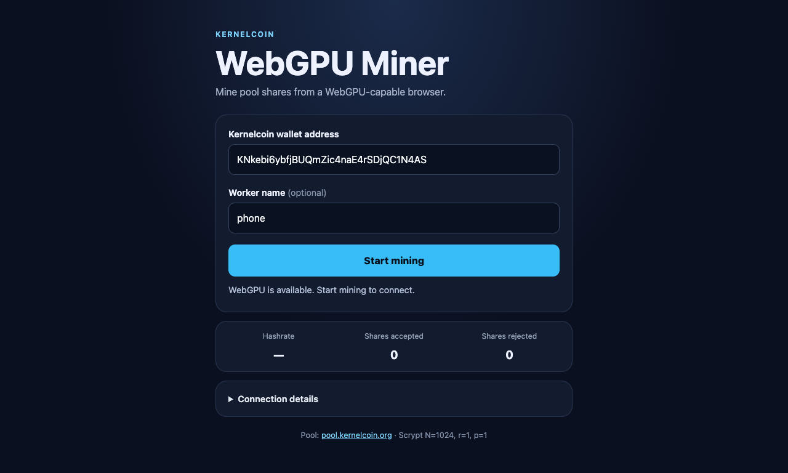

# webgpu-miner



A small browser miner for the Kernelcoin pool. It builds Stratum V1 jobs in the browser and scans nonce batches with the Scrypt WebGPU kernel carried over from the sibling `genesis-miner` project. The Node server serves the page and bridges WebSocket traffic to the pool's TCP Stratum port.

The project is informed by [`@marco_ciaramella/cpu-web-miner`](https://github.com/MarcoCiaramella/cpu-web-miner)'s browser-to-WebSocket-to-Stratum arrangement. That package targets different CPU algorithms and uses its own third-party relay; this app connects through a small fixed-destination bridge that you run yourself.

## Run locally

Requirements: Node.js 20 or newer, and a browser with WebGPU.

```sh
npm install
npm start
```

Open <http://localhost:8787> and start mining. The wallet field defaults to `KNkebi6ybfjBUQmZic4naE4rSDjQC1N4AS`; you can replace it with another Kernelcoin address. The worker name is optional. Pool authorization uses password `x`. The default upstream is `pool.kernelcoin.org:3333`.

The server listens only on `127.0.0.1` by default and only allows same-origin WebSocket connections. It supports being mounted under a reverse-proxy path such as `/miner/`; the included `Caddyfile.example` shows this alongside the pool website. To change the upstream or bind address for a deployment, set `STRATUM_HOST`, `STRATUM_PORT`, `HOST`, and `PORT` in the Node process environment. Keep the Stratum destination fixed to a pool you control; the bridge intentionally is not a generic TCP proxy.

## Use from a phone

WebGPU requires a secure browser context. `localhost` works on the computer running the app, but on a phone `localhost` means the phone itself. To use a server on your computer, put it behind HTTPS on a hostname reachable from the phone and proxy both HTTP and WebSocket traffic to `127.0.0.1:8787`. Keep the browser tab open and the screen awake; mobile operating systems may throttle or suspend background GPU work.

The mobile UI uses a batch of up to 256 lanes. Each Scrypt nonce uses 128 KiB of GPU scratch memory, so a 256-nonce batch needs up to 32 MiB. The batch is clamped to the device's reported storage-buffer limit. Actual speed and battery/thermal behavior depend on the phone and browser.

## Pool job implementation

- Algorithm: Scrypt `N=1024, r=1, p=1`, matching the Kernelcoin pool configuration.
- Coinbase and merkle root are rebuilt from Stratum V1 job notifications.
- Share targets account for the pool's configured Scrypt `shareMultiplier` of 65536.
- The browser submits `mining.submit` shares through the local bridge.

This is an experimental test-coin miner. Confirm that the pool accepts shares and monitor its worker dashboard before leaving it running.
